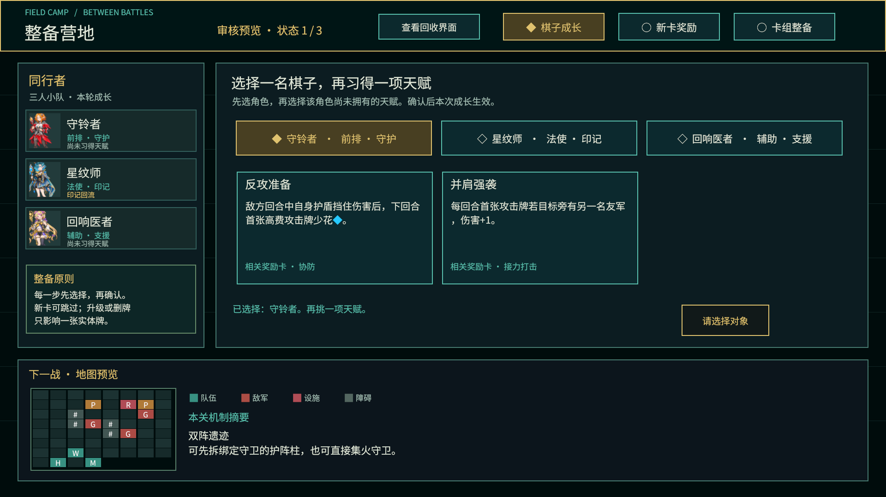
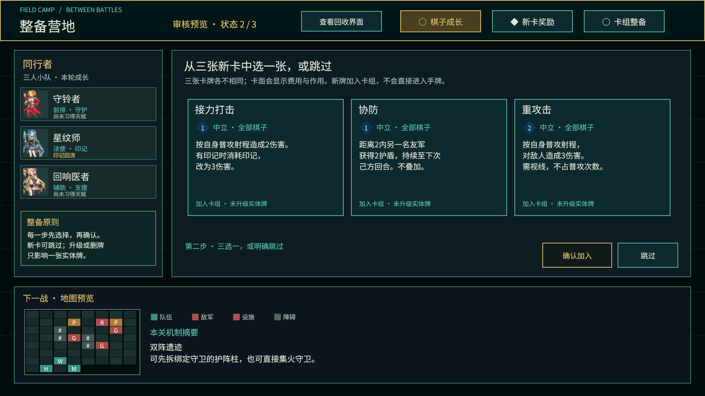
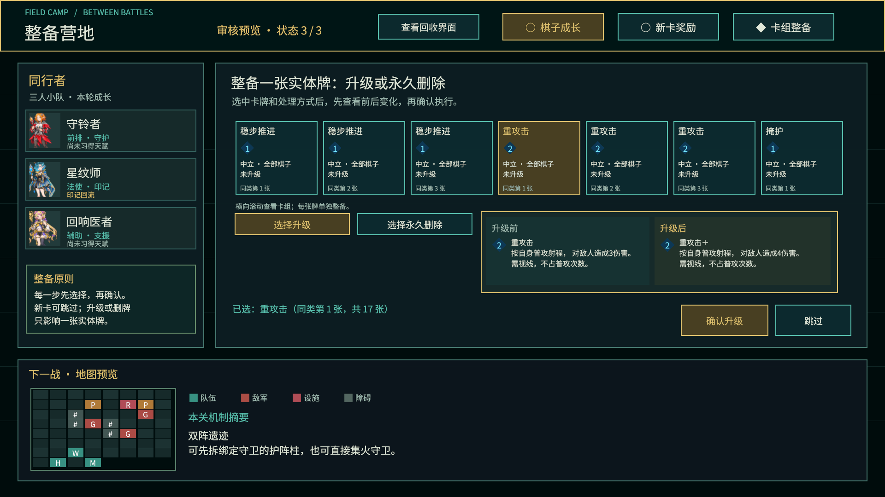
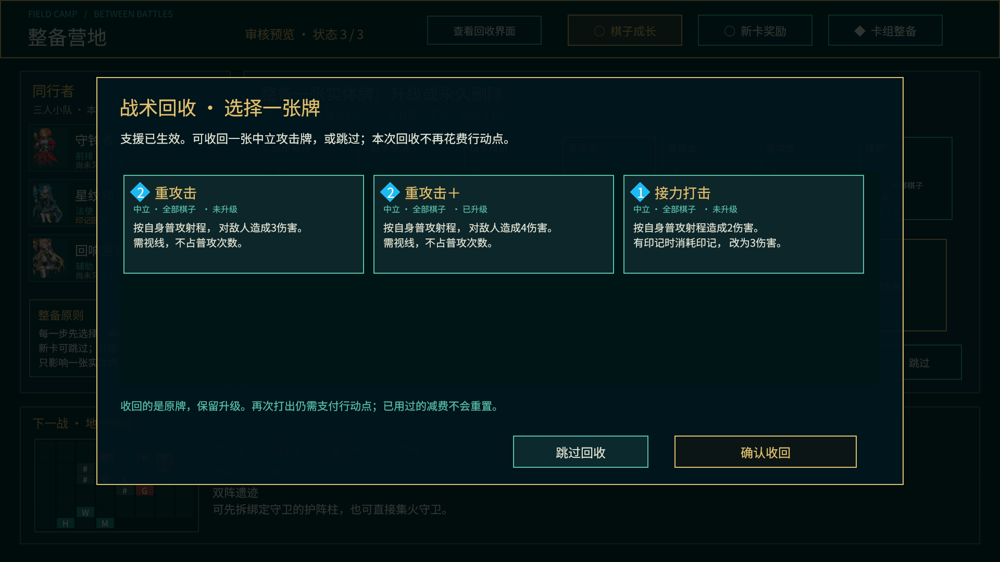

# 三关营地与回收界面 · Unity审核稿

状态：**用户已批准**。2026-10-22用户对成长、新卡、整备和回收四张截图回复“这套布局通过”。以下均为Unity运行截图，不是外部设计图。

工程：`Prototypes/VC5PvE`。审核场景：`Assets/VC5PvE/Scenes/CampaignReview.unity`。
打开后按Play，上方可切换三个营地步骤或打开回收界面。审核场景使用示例数据，不会改正式战斗存档。

## 1. 棋子成长

先选角色，再选其未获得的天赋，最后确认。只有两项天赋可供比较。

## 2. 新卡奖励

三选一，也可跳过。显示蓝色菱形费用、使用者和完整效果。新牌加入本轮卡组。

## 3. 卡组整备

横向滚动选一张实体牌，再明确选升级或删除；确认前比较效果或剩余牌数。默认不会选择删除。

## 4. 回收选择

可区分同名升级牌。选牌后确认收回；天赋回收可跳过。回收战术卡使用同一布局，取消不扣费。

## 审核重点

- 三步营地的顺序、确认/跳过是否清楚。
- 单张升级/删除的前后对照是否容易理解。
- 回收面板是否能看清牌的费用、效果与升级状态。

所有图为1920×1080。完整实现/测试记录见 `Docs/Plans/2026-10-21-VC5PvE三关成长实施计划.md`。正式试玩从Title进入。

补充：`05-stage-two.png`、`06-stage-three.png` 是排查跨关残留障碍时的诊断截图，包含已定位的粉色旧障碍，不能当作最终验收图。代码已修正障碍父节点，等待恢复Unity工具额度后重新编译、复验和替换这两张截图。四张获批UI稿不受此问题影响。

### 2026-10-22 后续复验已完成

旧诊断图05/06保留用于追溯。已在同一运行会话依次重建第一、二、三关，检查新图 `07-stage-two-verified.png`、`08-stage-three-verified.png`（1366×768），未见旧障碍残留或粉色失效材质。实际两次营地按钮跨关流程的障碍数量/材质断言也已通过。`09-camp-small.png` 补充1366×768营地显示检查；本组图片为调试摆场/界面检查，不是自然通关录像。
