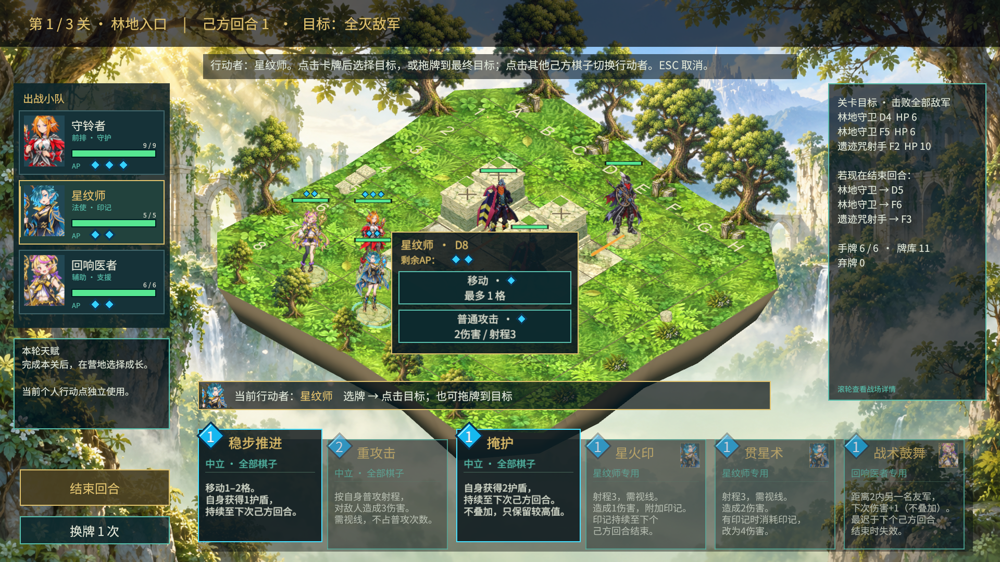
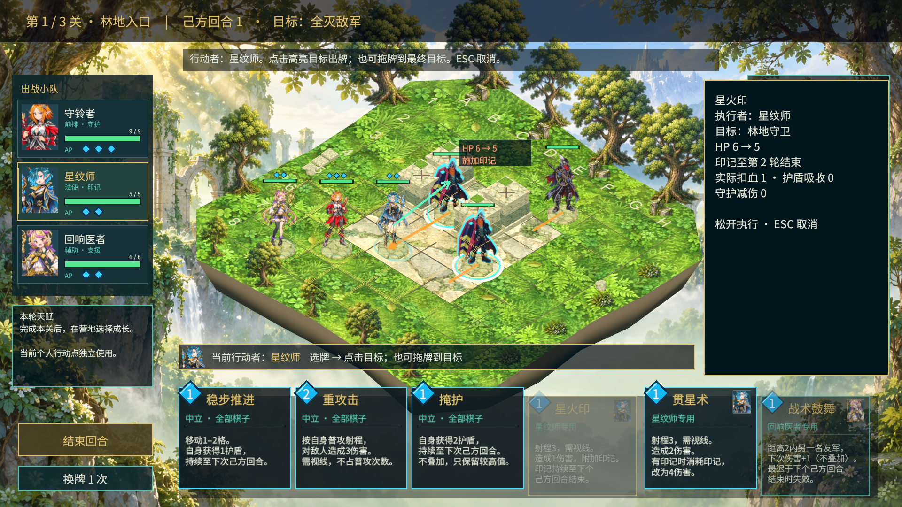

# 先选棋子、对目标出牌：运行画面

2026-10-22，用户已批准方案一。以下为现有Unity工程真实运行截图，未使用绘图模型替代游戏画面。

- `01-selected.png`：1920×1080，从标题进入，选中星纹师；手牌原位显示可用/不可用状态，新提示条已避开上浮卡牌。
- `02-target-preview.png`：1920×1080，星纹师拖星火印到林地守卫。箭头从行动者发出；牌面留在原位淡出，显示生命、印记和费用闪烁预览。
- `03-target-preview-small.png`：1366×768，同一预览。为展示射程内目标，截图现场通过调试把星纹师置于D6；非自然通关记录。
- 同一实机流程松手后：目标HP从6到5，星纹师AP从2到1，手牌从6到5。截图与用例均不代表三关难度或30分钟节奏已经平衡。

完整交互规则、自动化测试与编辑器状态见 [实施计划](../../Plans/2026-10-22-VC5PvE选人后目标出牌.md)。
