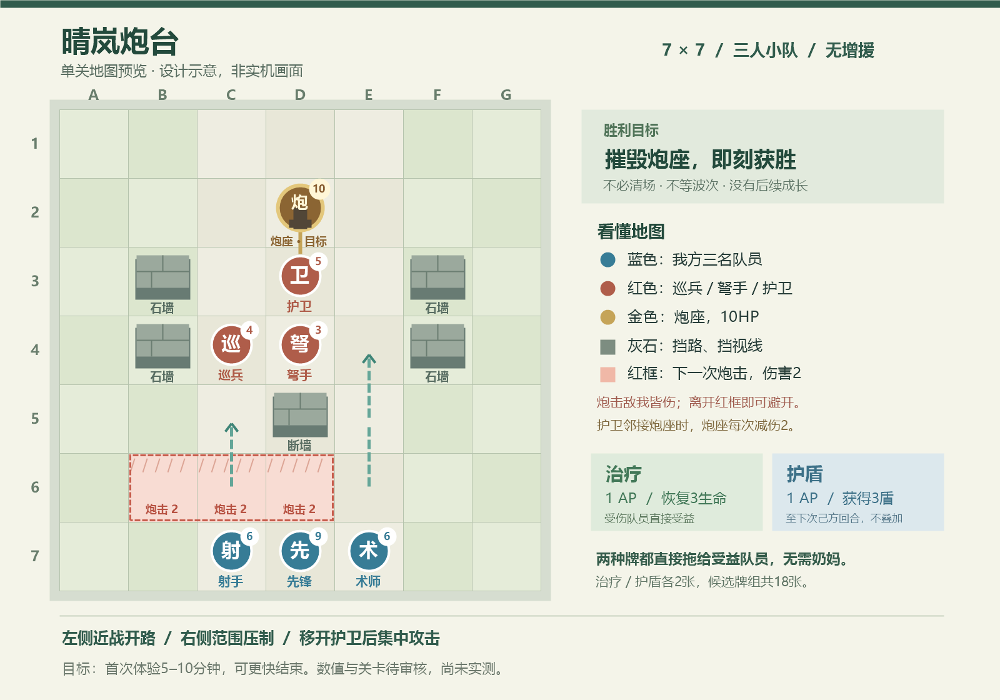

# 晴岚炮台｜单关设计预览

状态：待审核、未实现；不是Unity运行截图，不代表重要UI已经批准。

设计：[晴岚炮台单关设计](../../VC5PvE_晴岚炮台单关设计_待审核_20261029.md)。地图与纸面行动例以该文档的坐标/规则为准。

本次交付：[精确平面预览 qinglan-layout-v1.png](qinglan-layout-v1.png)，1600×1120。按坐标直接绘制的新设计图，源脚本为 [render-map.ps1](render-map.ps1)，不是游戏代码或实机截图。没有安装依赖，也没有修改游戏素材目录。

另曾请求内置 image_gen 制作插画式预览，但在本轮检查期间未返回结果，已终止等待；交付不采用其未知结果，没有切换API脚本或其他图像模型。精确图独立按规则坐标绘制，不是对生成图片的修改。

图中必须有：7×7棋盘；我方C7射手、D7先锋、E7术师；敌方C4巡兵、D4弩手、D3护卫、D2炮座；B3/B4/D5/F3/F4五格实体障碍；B6/C6/D6首次炮击预告。治疗/护盾小图为规则说明，不是已批准卡面或HUD。

主模型已完成文档坐标、首轮移动路径、术师三目标范围、18张牌数和首轮手牌/AP账本的纸面核对。已打开PNG目检：7×7格、7个单位、5格障碍、B6/C6/D6红框与文档一致，文字未见裁切。导出脚本的坐标数组表达式曾报错，定位后修正并成功重新导出。5–10分钟仍是目标，未自然试玩。
