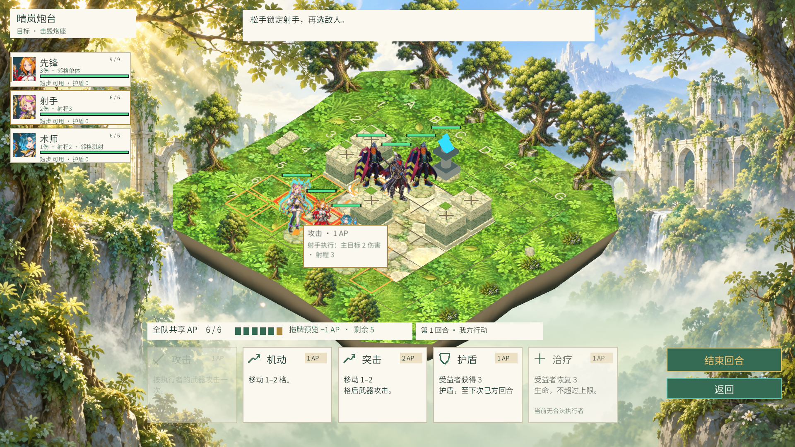

# 晴岚炮台关卡、交互与界面设计

> 版本基线：2026-11-16（聚焦教学更新）。本文记录独立共享 AP 原型当前可核对的关卡、交互和界面实现，供策划直接编辑。已实现内容来自 `SharedRules`、`SharedBattleController`、`SharedHud`、`SharedArtilleryView` 与晴岚场景；旧方案、试玩结论和待确认设计分开标记。牌张效果、费用和抽牌细则统一维护在[共享 AP 玩法规则与完整牌表](共享AP玩法规则与完整牌表.md)，本稿不再复制通用牌表。

**审核方式**　直接修改正文。希望调整的行为标 `【待实现】`，未定的问题写 `【讨论】`。可对照[本版已实现基线](Archive/2026-11-13-首战教学实装基线.zip)。

## 已实现 · 聚焦实操教学（2026-11-16）

**本节已获用户审核并明确授权实现，已接入 Unity；下方旧九步路线仅保留为历史。** 用户要求实际游戏中准确框住操作对象。设计参考本地 Figma「C3-V3R4 教学引导审核 v3（实际画面校准）」的对象框选与实操推进方式，以新实机校准页 483:7472 为实施依据。[审核图与核对记录](ArtReviews/2026-11-16-晴岚聚焦教学/README.md)，[实施计划](Plans/2026-11-16-晴岚聚焦教学实施.md)。所有锚点从实际 UI、卡牌实体、棋子和地面投影获取，禁止照抄设计图坐标。

### 目标与表现

- 教学分为「认识队员 → 移动与出牌 → 普通攻击 → 回合交接」四段。屏幕一次只要求一个动作，不要求玩家理解状态编号或记住坐标。
- 金色描边直接框住当前可操作的头像、手牌、棋子、地面格或按钮；小提示贴近框边，用“按住”“拖到”“松开”“点击”明确区分动作。读取角色信息时说明放在左侧详情旁，不能遮住技能图示。
- 非本步对象轻度压暗、不能改变战局。目标周围的战场和已展开详情仍可看；不增加常驻深色大面板。提示不能覆盖目标，拖牌时不能挡住鼠标／手指或接收者。
- 拖牌分成“拿起指定牌”和“进入正确队员的预览”两个视觉状态。悬停时显示真正的移动／攻击范围与预计费用，松手只在动作成功锁定或结算后推进；移出接收者则恢复拖动提示。教学不再画容易被误当攻击路线的大箭头。
- 当前步的高亮、点击允许区域和实际接收对象必须来自同一个目标。Unity 实现时从 UI 矩形、实际棋子和地面格投影动态取框，跟随分辨率、手牌收拢和角色移动。Figma 示例坐标只用于设计审核。

### 玩家动作与推进合同

固定 seed17 起手与关卡规则不变。审核帧中的悬停、误操作和退出样例是同一步的不同状态，不额外增加玩家点击。除两处信息阅读按钮外，不用“下一步”代替实际操作。

| 审核状态 | 框选和玩家文案 | 唯一正常推进条件 | 完成后的真实状态 |
|---|---|---|---|
| A1 认识队员 | 术师头像：“点击术师，看看她能做什么” | 点击指定头像并成功展开术师详情 | 仍为 6 AP／5 张牌；详情显示生命、武器、射程图和战技图 |
| A2 阅读信息 | 左侧详情及 AP 条：“生命、射程和战技都在这里” | 玩家点击提示中的“看看免费短步位置” | 只结束阅读，不产生游戏行动；下一步再点击地面足迹 |
| B1 免费短步 | E6 地面足迹：“点这个足迹，免费走一格” | 术师短步到 E6 成功，演出结束 | 6 AP／5 张牌；该术师本轮短步已用 |
| B2 拿起机动 | 机动牌与 E6 术师：“按住机动，拖到术师身上” | 指定牌拖入指定术师时只切换预览子状态 | 不提前扣费、不移除牌 |
| B2-P 机动预览 | 术师与移动范围：“现在松手，选定术师” | 松手且执行者实际锁定为术师 | 进入选落点，仍为 6 AP／5 张牌 |
| B3 机动落点 | E4 单个空格：“点亮起的空格，走到这里” | 机动牌使术师从 E6 经 E5 到 E4，结算与演出结束 | 5 AP／4 张牌 |
| B4 拿起战技 | 战技牌与 E4 术师：“把战技拖给术师” | 指定战技拖入术师时只切换预览子状态 | 显示星火爆裂与合法射程，暂不选敌 |
| B4-P 战技预览 | 术师与施放范围：“松手选定术师，再选敌人” | 松手且执行者实际锁定为术师 | 进入选敌，仍为 5 AP／4 张牌 |
| B5 范围伤害 | D4 弩手：“点框中的弩手，一次打中三名敌人” | 术师战技以 D4 为中心成功结算，演出结束 | 弩手 1 HP、巡兵 2 HP、护卫 3 HP；4 AP／3 张牌 |
| C1 选择射手 | 射手棋子：“点击射手棋子”；补充“点击左侧头像也可选中。” | 点击棋子或左侧头像，射手选中且普攻目标生成 | 左侧详情更新，C4 巡兵显示剑标 |
| C2 普通攻击 | C4 巡兵及剑标：“点击剑标：消耗 2 AP，不用出牌” | 射手对巡兵普攻成功，演出结束 | 巡兵倒下；2 AP／3 张牌 |
| D1 保护前排 | 护盾牌与 E4 术师：“把护盾拖给术师，挡住下一轮伤害” | 指定护盾给术师成功结算 | 术师 3 盾；1 AP／2 张牌。该牌松手直接生效，不需要再点敌人 |
| D2 结束回合 | 结束回合按钮：“点击结束回合，看看怎样留牌” | 弃牌选择界面实际打开 | 尚未发动敌方行动，默认零弃牌 |
| D3 留牌确认 | 手牌和确认按钮：“想留下的牌不用点” | 玩家确认当前弃牌选择 | 默认保留攻击、突击；允许选弃／再次点选撤销，提示实时显示实际弃／留／补牌数 |
| D4 观察敌方 | 当前行动敌人或炮弹落点：“敌人行动中，红格是炮击位置” | 敌方行动及全部演出完成，真正进入下一玩家回合 | 默认零弃路线：6 AP、5 张牌、术师 4 HP；不靠固定计时猜测完成 |
| D5 开始自由战斗 | AP 条及补入的手牌：“AP 恢复了，留下的牌还在” | 玩家点击“开始自由战斗” | 重置本关至固定 seed17 初始战局（第1轮、6AP、五张固定起手、全员／敌人生命与站位恢复），关闭教学并允许自由操作 |

新护盾步骤使用现有规则，花 **1 AP**。零弃牌路线经当前 `SharedRules.cs` 实际执行：最终保留攻击／突击，补入猛攻／护盾／机动；术师敌方阶段后 4 HP、盾清零。选择弃牌时必须按实际选择计算，不能固定声称“保留 2、补 3”。这是纯规则验证，尚非新教学 Unity 验收。

留牌的选中上浮画面是 D3 可选分支，不要求玩家必须弃牌或先选再取消。D5 的“留下的牌还在”适用于有保留牌的情况；若全部弃掉，应显示“AP 恢复了，手牌已补满”，不得描述不存在的保留牌。

### 防止提示与战局失配

1. **严格实操阶段**：只接受当前要求的牌、执行者、目标、落点和按钮；同一目标的合法点击范围仍按实际地板／棋子命中处理。其他合法游戏行动在提交前被教学层拒绝，不能先消耗资源再纠正。仅拿起牌、悬停、误点或点击提示背景均不算完成。
2. **错误与取消**：错牌、错人、错落点时保留当前步骤，目标框轻闪，短提示“先完成框中的操作”。拖到空白松手不扣资源；选落点／敌人时 Esc、右键或返回退到本张牌的拖入步骤。弃牌页返回则回 D2，清除未确认的选弃。不能悄悄切换成自由提示。
3. **演出期间**：显示“正在移动／攻击”，暂停下一步的输入，不在棋子还未到位时显示下一处目标。成功动作只记录一次；只接受当前步骤、对应行动和当前战局的完成事件，忽略过期回调。
4. **主动退出**：跳过教学始终可见；动作演出期间暂不可点击。点后提示“退出引导，继续当前战局；已完成的行动会保留”，可继续教学或确认退出。确认后取消未结算的预览／选弃、解除所有输入限制；不退还已花 AP、不偷偷重置关卡。
5. **异常恢复**：若目标消失、牌缺失、镜头锚点不可用或真实局面不再满足本步前提，停止推进并清除错误框，暂停战斗输入，给“退出引导继续本局”与“重新开始教学（会重置本局，二次确认）”。不凭不存在的对象继续发指令。胜负发生则优先解除教学并显示结算。
6. **应用范围**：固定演示开局使用新引导；随机挑战不套用固定坐标脚本。自由战斗保留常规范围／费用预览，不继续弹过期的强制教程。触屏与鼠标使用同一动作合同，拖动手指覆盖目标时提示需要避让。

### 审核与实现边界

本次已按用户批准的实机校准稿接入 Unity。运行时以 SharedFocusOverlay 动态读取实际 UI 矩形、卡牌实体、UnitView 当前精灵四角及 Board.World 格角投影；LateUpdate 跟随布局、卡牌上浮、棋子移动和镜头变化。Figma 坐标不写入实际锚点。提示会避让当前目标、左侧详情和手牌；拖牌范围及伤害预览仍来自实际规则。

已实现提交前门禁、真实松手锁定、动作演出完成后推进、选点取消退回本牌拖入步骤、留牌可选分支、退出确认与缺失目标恢复。2026-11-17 更新：D5 点击“开始自由战斗”重置到固定 seed17 第1轮初始战局并关闭教学；随机挑战直接自由战斗。中途“跳过教学”仍保留当前战局。留牌提示按实际选择显示“弃／留／补”数量，全弃后使用“手牌补满”标题。敌方阶段跟随当前行动敌人或炮击格，行动演出时暂不接受跳过。

已在 1920×1080 晴岚实机走通整条控制器／拖动组件路线，拍摄并查看短步、拖牌、战技、普攻和留牌画面，见[实现截图与验收](ArtReviews/2026-11-16-晴岚聚焦教学/implemented/README.md)。首轮资源与设计账本一致，第2轮为 AP6／5张牌／术师4HP。自动化验证相机变化后角色框仍包围实际精灵、短步锚点对准真实格、真实 CardDragInput 可以完成拖入。

尚未验证真人首次理解程度、Android 触屏和不同设备画幅；自适应锚点已接入，但不能将 1920×1080 截图视为全部分辨率验收。历史 Figma 素材保留，不覆盖为实现截图。

## 历史 · 固定开局九步教学（2026-11-13，已被上述聚焦教学替换）

这是一条同一玩家回合内能走通的推荐路线。棋盘保留原晴岚位置。按动作给出下一句提示，玩家可跳过或走自己的路线；结算数值以[玩法总稿](共享AP玩法规则与完整牌表.md)为准。九张[本地 Figma 画面与导出索引](ArtReviews/2026-11-13-晴岚首战教学/README.md)用俯视棋盘标清格子，Unity 仍使用既有斜视场景。已接入 Unity 的真实操作提示和棋盘标记。

| 玩家眼前的提示 | 亲手操作后发生什么 |
|---|---|
| ① 点术师头像 | 展开生命、武器射程、战技说明。左上目标告诉玩家两种胜法，头像旁的数字是生命，手牌上方的 AP 是全队预算。 |
| ② 点 E6 的足迹 | 术师由 E7 短步至 E6。AP 仍是 6，仍有五张牌。只有该术师本轮的免费短步用掉。 |
| ③ 把机动拖给术师 | 手牌显示 1 AP 费用，拖入只预览，松手才锁定；支持等价的点牌再点队员。 |
| ④ 点 E4 落点 | 术师经 E5 到 E4，花 1 AP，剩 5。从 E4 可以看到 D4 的弩手。 |
| ⑤ 把战技拖给术师 | 卡在不同队员上显示冲撞、架弩、星火爆裂三种结果。选择术师，进入选敌。 |
| ⑥ 点 D4 弩手 | 先预览十字内实际命中者。弩手 3→1、巡兵 4→2、护卫 5→3，术师自己安全。剩 4 AP、3 张牌。 |
| ⑦ 点射手头像或棋子 | 角色详情切为远程单体，C4 残血巡兵出现普攻剑标。 |
| ⑧ 点巡兵的剑标 | 普攻花 2 AP 击倒巡兵，三张手牌都还在。AP 6→5→4→2 的变化分别对应机动、战技和普攻。 |
| ⑨ 点结束回合，查看留牌 | 只选要弃的牌。示例零弃、留攻击／突击／护盾，若战斗继续，次轮补猛攻与护盾。确认前可以返回，用剩余 AP 给前排队员加盾。 |

**自由操作与取消**　推荐路线按当前教学步和实际提交的动作推进。玩家实际走了其他落点、出了其他牌或提前进入下一轮，就切换为按可执行动作给提示的自由教学。取消机动或战技的选目标阶段，会退回交牌提示，手牌和 AP 保留。随机挑战直接使用自由提示，可随时在己方行动时跳过教学。

**实机核对与待试玩项**　用现行代码校验了短步、机动、两段视线和射手普攻。已在实际晴岚场景验证爆裂和敌方行动，十字预览与实际扣血使用同一次规则试算。在这条示范线直接空过剩余 2 AP，术师下轮只余 1 HP；这是新手压力的待测点，结束回合前可自由用护盾，不强制弃牌。九图为审核示意；新手理解程度仍待真人试玩。

## 1. 关卡定位与目标

- **关卡名：**晴岚炮台。
- **模式：**三名队员对阵巡兵、弩手、护卫和炮座的单场战斗；全队共用 AP。
- **胜利条件：**摧毁炮座，或击败巡兵、弩手、护卫三名敌兵。击毁炮座时，即使敌兵仍在场也胜利；炮击若导致最后一名敌兵倒下，也立即胜利。
- **失败条件：**三名己方队员全部倒下。胜利条件先检查，因此同一结算中先满足胜利条件时按胜利结束。
- **战斗结束后：**显示胜负、胜利原因、回合数和简短结语；可用「再试一次」重开固定教学起手，或用「随机手牌再挑战」重开随机起手。
- **体验目标（待试玩验证）：**本关用同一战场呈现共享资源管理、卡牌执行者选择、免费基础行动、炮击预警与双胜利路线。难度和教学节奏尚未通过真人试玩确认。

## 2. 棋盘、出生位置与障碍

棋盘为 7×7。坐标列为 A–G、行为 1–7；下表按 A1 左上、G7 右下绘制，游戏画面使用斜视镜头。下图是按规则坐标整理的初始布局，数字 HP 为开局值；空白格未标地形。

| 行\列 | A | B | C | D | E | F | G |
|---|---|---|---|---|---|---|---|
| 1 | · | · | · | · | · | · | · |
| 2 | · | · | · | 炮座 10 | · | · | · |
| 3 | · | 障碍 | · | 护卫 5 | · | 障碍 | · |
| 4 | · | 障碍 | 巡兵 4 | 弩手 3 | · | 障碍 | · |
| 5 | · | · | · | 障碍 | · | · | · |
| 6 | · | · | · | · | · | · | · |
| 7 | · | · | 射手 6 | 先锋 9 | 术师 6 | · | · |

护卫开局在 **D3，5 HP**；初始炮击预告落点为 **B6、C6、D6**。五个规则障碍位于 **B3、B4、D5、F3、F4**。单位和障碍占格，普通移动不能进入；射击还会检查障碍遮挡。

> 策划编辑提示：这张图对应规则模型坐标，不承诺每个美术场景贴花或装饰物都属于规则障碍。若调整出生点、障碍或炮击格，请同时复核合法路径、射线遮挡和首轮炮击风险。

## 3. 敌方行动与炮击节奏

敌方每回合按**巡兵 → 弩手 → 护卫 → 炮座**顺序逐个结算。每个敌人先按当前棋盘判断可攻击目标；若没有可攻击目标，则沿合法路径接近能攻击的位置，再检查是否能在本次行动攻击。近战单位移动后可攻击；一旦可攻击就停下。障碍、其他单位、武器射程和视线共同决定合法目标。

| 敌人 | 开局位置 / HP | 当前攻击与移动 | 与炮座的关系 |
|---|---|---|---|
| 巡兵 | C4 / 4 | 近战，伤害 3；没有可攻击目标时每次敌方行动最多前进 1 格，移动后可攻击 | 无特殊保护 |
| 弩手 | D4 / 3 | 射程 3，伤害 2；没有可攻击目标时每次敌方行动最多前进 1 格，移动后可攻击 | 无特殊保护 |
| 护卫 | D3 / 5 | 近战，伤害 3；没有可攻击目标时最多前进 2 格，移动后可攻击 | 与炮座曼哈顿距离为 1 时，炮座每次受伤减少 2 点，最低为 0 |
| 炮座 | D2 / 10 | 每回合对预告的 3 格齐射，每格 2 点伤害；命中格内的存活单位会受伤，包括敌兵 | 可被攻击；护卫邻接时有减伤 |

敌人原地有多个合法目标时，优先距离最近的，再比较剩余生命，优先较低者。追击时比较能发动攻击的落点路径，先取最短路线，再依次比较目标生命、单位列表顺序和落点行列。

炮座初始预告固定为 B6–D6。玩家回合期间显示红色落点框与虚线弹道，弹道示意不造成伤害、不改变预告。敌方阶段按规则快照逐枚发射实弹，显示尾迹和落地点冲击环，再更新受击；战斗若中途结束，只演出已经结算的落点。战斗继续时，存活炮座在齐射后重新选择覆盖己方队员数量最多的横向连续三格；覆盖人数相同时，先比较覆盖队员中的最低生命，再按起点行号、列号从小到大选定。预告锁定后，玩家离开红格即可躲避。

炮座意图和实际齐射示意：[玩家阶段炮击预警动图](ArtReviews/2026-11-10-SharedAP/warning.gif)、[敌方阶段实弹齐射动图](ArtReviews/2026-11-10-SharedAP/live.gif)。

## 4. 玩家操作流程

### 4.1 选人、出牌与目标

1. 点击左侧队员头像或棋盘上的己方棋子，展开该角色详情；选中后棋盘显示该队员当前合法的免费短步格和可普攻敌人标记。
2. 可先点一张手牌查看可执行队员，也可直接把牌拖到己方棋子或左侧队员头像。拖过合法队员时显示该执行者的范围、效果与 AP 预览；松手锁定执行者。
3. 已选牌后点一名可执行队员，也可完成等价的「选牌→选执行者」流程。治疗、护盾和射手架弩等直接生效牌在合法接牌后立即结算；攻击牌等目标行动则进入瞄准阶段。
4. 瞄准阶段只高亮规则允许的目标或落点。悬停目标显示行动预览；点击合法目标即执行并扣除费用、移除手牌。攻击不是额外弹出二次确认框。
5. 突击先选合法移动落点，再选可攻击敌人；点落点只锁定第一阶段，不扣 AP 或消耗牌。最终点敌人时才结算。若无可完成的落点，提示先用短步或机动靠近。
6. 点击棋子后可直接点高亮空格执行免费短步，或点带剑标的合法敌人执行普通攻击；短步和普攻各自受每名队员每轮一次限制。

鼠标 **Esc** 或右键取消当前选牌、预览和瞄准；界面「返回」按钮有相同用途。取消不消耗 AP 或手牌。结束回合不是立即发动敌方行动：先进入弃牌阶段，默认零弃牌；点选要弃的牌后确认，未选的牌保留，敌方行动后补牌至最多 5 张。弃牌阶段按「返回」清空当前选择，仍可重新确认。

### 4.2 状态与取消规则

| 当前状态 | 玩家能做什么 | 取消/确认结果 |
|---|---|---|
| 我方待机 | 选择队员、选牌，或点击已高亮的基础行动格/敌人 | 点击另一队员会切换角色 |
| 拖牌预览 | 将牌移到其他合法队员比较效果；查看 AP 预览 | 松手到合法队员锁定执行者；拖到空白/无效目标取消 |
| 选目标 / 选落点 | 点击高亮目标或格；悬停检查行动预览 | Esc、右键或「返回」清空瞄准；不扣费、不弃牌 |
| 突击第二阶段 | 选择落点后再选择敌人 | 选敌人结算；取消回到待机，不扣资源 |
| 弃牌 | 选中本轮要弃的牌，可零弃牌直接确认 | 确认进入敌方阶段；返回清空弃牌选择 |
| 敌我演出或结算 | 输入锁定 | 演出完成后恢复操作；胜负后显示结果面板 |

屏幕命中在队员立绘与格子重叠时优先当前合法候选；落点阶段按地面格选取，避免高立绘误选邻格。真人鼠标和触屏的遮挡手感仍待试玩。

## 5. 教学推进与退出

固定起手按本文开头九步推荐路线推进。选人、确认落点、出牌、普攻均由真实动作触发。棋盘提示 E6、E4、D4、C4，操作期间仍显示合法格与规则预览。取消正在选落点的机动或正在选敌的战技会返回对应的交牌步骤。最后可以支出剩余 AP，或直接留三张确认结束。实测进入第 2 轮时，共享 AP 为 6，手牌为攻击、突击、护盾、猛攻、护盾。

提前结束回合或实际执行其他路线时切换为自由提示，按是否已经出过牌、短步、普攻和确认过回合补教。随机挑战直接使用自由提示。点击「跳过教学」后可以继续所有正常操作。

## 6. 界面结构与信息层级

### 6.1 当前界面框架示意

```text
左上：关卡名和双胜利目标                 顶部：当前一步的操作提示
左侧：出战小队、生命、武器简述           中央：晴岚棋盘、敌我棋子、范围和炮击预告
点人后：左侧展开武器与战技图示
左下：跳过教学（适用时）                 手牌上方：全队 AP、预计消耗、回合状态
                                      底部：手牌           右下：结束回合／返回
```

界面按 1920×1080 参考分辨率布局。共享 AP 常驻手牌上方，拖牌时显示预计费用和行动后余额。开局详情收起；点棋子或队员头像展开。直接拖牌时，手边的小卡显示执行者效果，棋盘显示该执行者的实际范围。

### 6.2 信息呈现约定

- **目标优先：**左侧常驻显示「击毁炮座 或 击败三名敌兵」；结算标题按实际胜利原因显示。
- **队员状态：**队伍栏呈现头像与生命；展开详情后查看武器伤害/射程、战技及使用状态。队员栏同步显示短步是否可用和当前护盾。
- **行动反馈：**可行动格、敌人、落点和伤害预览使用不同标记；AP预览为暂态，不提前从实际资源中扣除。非法目标显示原因，不应用行动。
- **敌方预告：**炮击使用棋盘红框和弹道，不依赖文字列表；敌兵移动/攻击通过当前意图提示和逐步演出表达。
- **回合确认：**首次确认进入弃牌选择；确认按钮文案明确当前将「直接结束（不弃牌）」或「弃牌并结束」。
- **无障碍待审：**颜色之外是否补充形状/文字区分、较小分辨率适配和触屏命中范围，待策划与试玩审阅。

拖牌示例取自 11 月 9 日 GameView。图中使用当时的任务提示；当前胜利条件以第 1 节为准。



[点棋子后的详情](ArtReviews/2026-11-09-SharedAP-Unity/basic.png) · [弃牌阶段](ArtReviews/2026-11-09-SharedAP-Unity/discard.png)

## 7. 当前实现状态与待审项

### 已实现基线（截至 2026-11-13）

- 独立共享 AP 规则、晴岚 7×7 规则地图、障碍遮挡、初始炮击格、敌方顺序和胜败判定。
- 共享 HUD、角色详情、牌到执行者的拖放/点选流程、合法目标和行动预览、取消入口、免费短步/普通攻击提示、弃牌确认与教学跳过。
- 炮击警告和齐射演出，敌方移动路径逐格展示；护卫追击上限及邻炮减伤按规则结算。
- 实施记录截至 11 月 10 日记载：全量 PlayMode 72/72、EditMode 87/87；另有该版本固定局的实际场景记录。此处引用记录而非本次重新运行 Unity，计数不能外推到 11 月 13 日之后的修改。

### 待试玩/策划审核

- 真人鼠标操作、立绘遮挡下的目标选择、触屏命中与小屏布局。
- 两种胜法的实际难度、炮击预警可读性、护卫保护价值、敌方追击节奏与总体回合长度。
- 教学文案是否足够清楚、提示出现时机、可跳过按钮的可发现性。
- 配色与标记的可辨识度、较低分辨率 HUD 的适配，以及本稿 ASCII 布局在最终美术中的优先级。

### 不应误记为已实现

- **待验证的体验目标**：首次体验约 5–10 分钟，允许更短；实际平均时长和胜率尚无系统统计。
- **未实现的历史表现建议**：敌人专属蓄力动画、移动终点虚影、仅显示悬停敌人意图的筛选。当前使用实际路径、攻击提示及炮座抛射演出。
- 触屏端完整验收、发布包验收、联网/设备性能数据。

## 8. 关联资料

- [共享 AP 玩法规则与完整牌表](共享AP玩法规则与完整牌表.md)：AP、手牌、费用、卡牌与抽牌的统一规则稿。
- [实现与审核记录](VC5PvE_共享AP晴岚炮台_实现与审核记录_20261029.md)：按日期记录实现变化、试玩反馈和验证边界。
- [出击与基础行动教学实施记录](Plans/2026-11-10-晴岚出击与基础行动教学.md)：教学状态和基础行动验收证据。
- [近战敌兵追击调整记录](Plans/2026-11-10-晴岚近战敌兵追击调整.md)：护卫/巡兵追击变化与固定场景压力样例。
- [当前 HUD / 交互验收图](ArtReviews/2026-11-09-SharedAP-Unity/README.md)：开场、拖牌、基础操作、弃牌阶段的图像说明。
